# User interface - Sports Venue Booking System

**Milestone 3 · Team 09 · Sprint 3 (05/10/2026 - 18/10/2026)**

Milestone 2 ([`design.md`](design.md)) proved that the system runs. This document shows
that people can use it: every P0 story works from start to finish through the interface,
with real data from the database, and every broken business rule gives a clear message.

To run it on a new machine, follow [`SETUP.md`](SETUP.md).

| Section                       | Owner             | Issue |
| ----------------------------- | ----------------- | ----- |
| 1. P0 stories and status      | @lequangk2006-sys | #70   |
| 2. Wireframes                 | @lequangk2006-sys | #70   |
| 3. Error messages             | @lequangk2006-sys | #70   |
| 4. What changed since M2      | @thunopro         | #71   |

---

## 1. P0 stories and status

Every P0 story from [`requirements.md`](requirements.md) section 4 is built and can be
completed through the interface, starting from the home page - no URL has to be typed.
Test accounts are in [`SETUP.md`](SETUP.md) section 6 (password `sanbong1` for all).

| Story | Screen(s) | Route | Status | Issue |
| ----- | --------- | ----- | ------ | ----- |
| US01 Customer registration | Create an account, Verify your email | `/register`, `/verify` | partly works - no email server yet, so the verification link is printed in the terminal and shown on screen instead of being emailed (section 4) | #65 |
| US02 User login | Sign in, then My page / My venues / Administration by role | `/login` → `/dashboard`, `/owner/venues`, `/admin` | works | #64 |
| US03 Customer searches for venues | Find a venue | `/`, `/search` | works | #66 |
| US04 Customer views venue details and availability | Venue detail | `/venues/{id}` | works - seeded venues have no photos yet; photos appear once an owner uploads one (US06) | #67 |
| US05 Customer books a venue | Book, Booking confirmed, My page | `/booking/{venueId}`, `/bookings/{code}`, `/dashboard` | works | #68 |
| US06 Venue owner adds a new venue | My venues, Add a venue | `/owner/venues`, `/owner/venues/new` | works | #69 |

**Where each story starts** (also on the first screen of the README):

| Story | Start here | Then |
| ----- | ---------- | ---- |
| US03 | Home page `/` | choose a sport and an area, press **Search**, or type 3 letters in *Name or sport contains* |
| US04 | a venue name in the search results | pick a date above the free-hour grid |
| US05 | a green **free - book** hour on a venue page | choose the length, check the price lines, press **Confirm booking** |
| US01 | **Register** in the top bar | after creating the account, press **Verify my email** in the blue box |
| US02 | **Sign in** in the top bar | a customer lands on My page, an owner on My venues |
| US06 | sign in as an owner → **Add a venue** | fill the form, press **Add venue** |

### Screen flow (updated from M1)

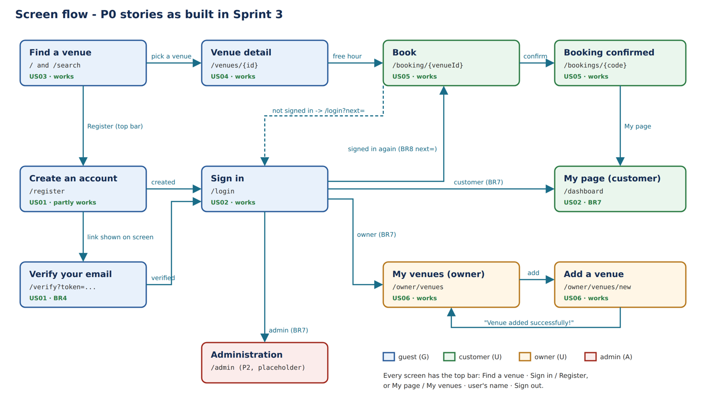

*Figure 1 - The P0 part of the M1 flow diagram
([`images/flow-diagram.png`](images/flow-diagram.png)) as it is built now. New since M1:
`/verify` (US01, BR4), `/bookings/{code}` (the confirmation a booking leads to, US05), and
the dashed arrow - a guest who clicks a free hour is sent to `/login` and comes back to the
same booking page after signing in.*

---

## 2. Wireframes

One wireframe per P0 screen, drawn before the screen was built, with a screenshot of the
screen as built underneath. Every page has the same top bar, so the wireframes leave it
out:

```
+----------------------------------------------------------------------------+
| Sports Venue Booking          Find a venue   Sign in   Register            |  guest
| Sports Venue Booking          Find a venue   My page | Pham Duc Minh  Sign out | customer
+----------------------------------------------------------------------------+
```

**How pages talk to the server.** Forms are plain HTML forms posted to the page's own
route; that route calls the same service function as the JSON endpoint in
[`design.md`](design.md) section 3 (see section 4 below). "Calls" lists the endpoint whose
data and rules the screen uses; "(form)" means it reaches it through the page route.

### 2.1 Find a venue - `/` and `/search` (US03)

"The user comes here to find a venue of one sport in one district."
Calls: `GET /api/venues?sport=&area=&q=` (form, GET).

```
Find a venue
+------------------------------------------------------------------------+
| Sport [Football  v]  Area [Cau Giay  v]  Name or sport contains [bad__] [Search] |
+------------------------------------------------------------------------+
 2 venue(s) found
 # | Venue (link)               | Sport    | Area     | Address           | Hours       | Price/hour
 4 | Nghia Tan Football Pitch   | Football | Cau Giay | 3 Nghia Tan       | 06:00-22:00 |   280,000
 1 | Thong Nhat Football Pitch  | Football | Cau Giay | 12 Tran Thai Tong | 06:00-22:00 |   300,000
 -- or, when nothing matches --
 +--------------------------- No venues found ---------------------------+
```

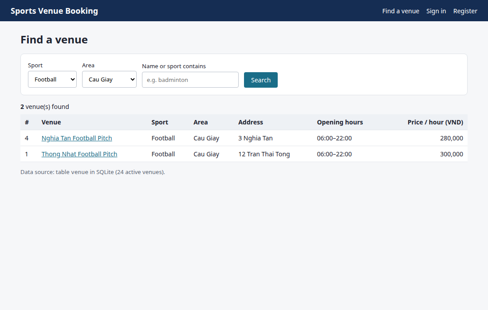

### 2.2 Create an account - `/register` (US01)

"The user comes here to create a customer account so they can book."
Calls: `POST /api/auth/register` (form), then `GET /api/auth/verify?token=` from the link.

```
+------------------- Create an account -------------------+
| [! Please fix the 3 field(s) marked below.            ] |
| Email         [minh@example.com      ]                  |
|               This email is already in use              |
| Password      [                      ]                  |
|               Password must be at least 8 characters    |
| Full name     [Nguyen Thi Hoa        ]  <- kept         |
| Phone number  [091234567             ]                  |
|               Phone number must be 10 digits            |
| [ Create account ]          Already have an account? Sign in |
+---------------------------------------------------------+
```

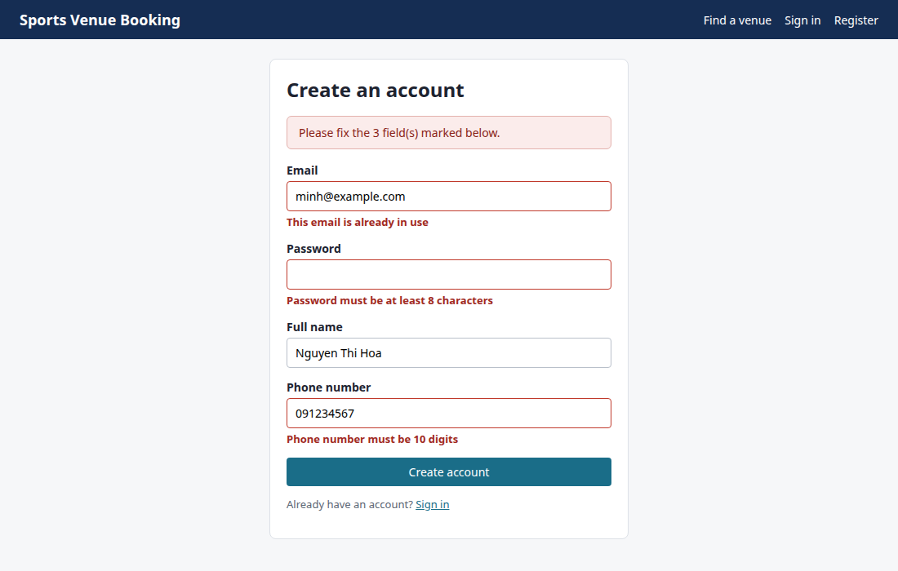
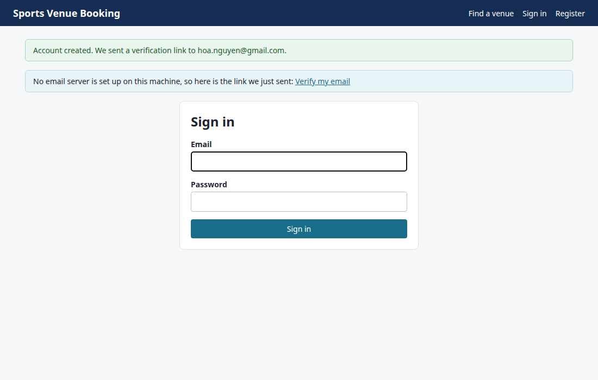

### 2.3 Sign in - `/login` (US02)

"The user comes here to sign in and reach their own area."
Calls: `POST /api/auth/login` (form).

```
+------------- Sign in -------------+
| [! Email or password is incorrect] |
| Email     [minh@example.com   ]   |
| Password  [                   ]   |
| [ Sign in ]                       |
+-----------------------------------+
  customer -> /dashboard   owner -> /owner/venues   admin -> /admin   (BR7)
```

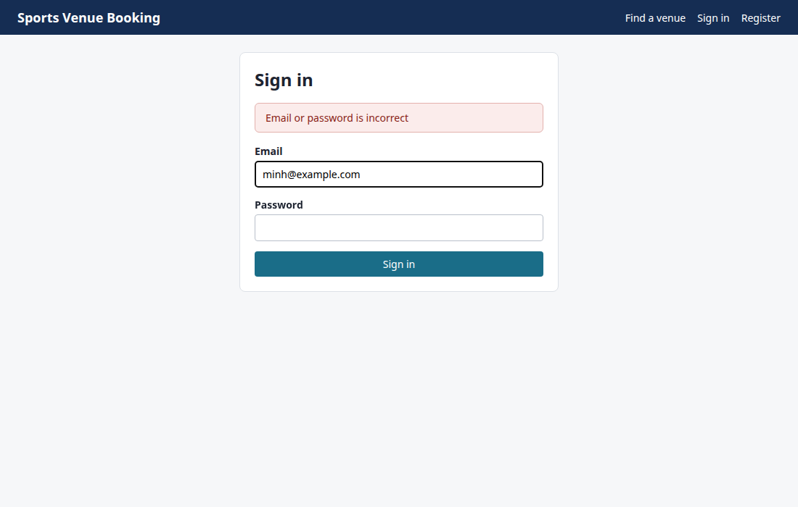

### 2.4 Venue detail - `/venues/{id}` (US04) - drawn in all four states

"The user comes here to see a venue and which of its hours are free on one date."
Calls: `GET /api/venues/{id}?date=YYYY-MM-DD` (JavaScript, again each time the date changes).

The venue facts and photos are part of the page; the free-hour grid below them is loaded
from the API, so it is the part that can be loading, fail, be empty or have data:

```
 Thong Nhat Football Pitch
 +------------------------------------------------------------+
 | Sport Football   Area Cau Giay   Address 12 Tran Thai Tong  |
 | Opening hours 06:00-22:00   Standard price 300,000 VND/h    |
 | [photo] [photo]           (or: No photos of this venue yet) |
 +------------------------------------------------------------+
 Free hours   Date [13/10/2026]

 +- Loading -----------------------+   +- Error --------------------------------+
 | (spinner) Loading free hours... |   | We can't reach the server. Check that  |
 |                                 |   | the app is still running, then try     |
 |                                 |   | again.              [ Try again ]      |
 +---------------------------------+   +----------------------------------------+
 +- Empty -------------------------+   +- Data ---------------------------------+
 | No free hours on 27/10/2026 -   |   | 13/10/2026: 13 free, 3 booked          |
 | every hour is booked, closed or |   | [06-07 free][07-08 free] ... [16-17]   |
 | over. Try another date.         |   | [17-18 booked][18-19 free][19-20 booked]|
 | (grid below shows why)          |   | [20-21 booked][21-22 free]             |
 +---------------------------------+   +----------------------------------------+
```

| Loading | Error |
| ------- | ----- |
| 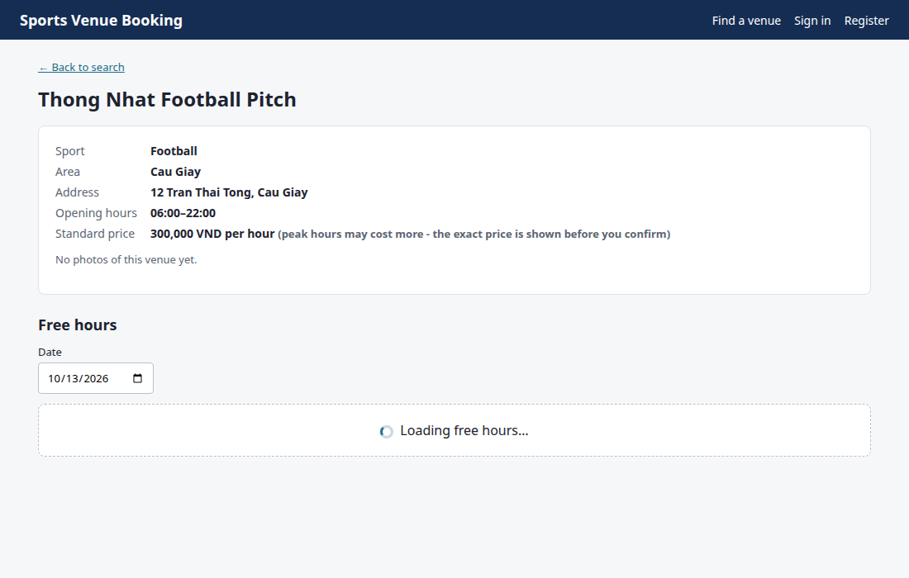 | 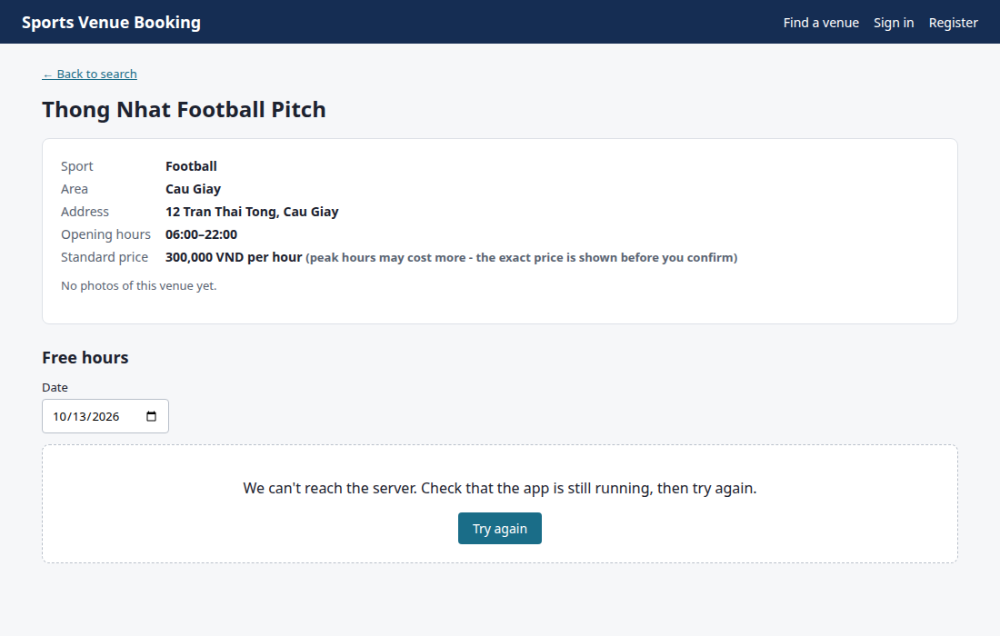 |
| **Empty** | **Data** |
| 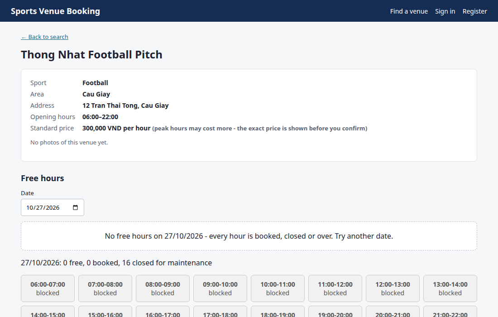 | 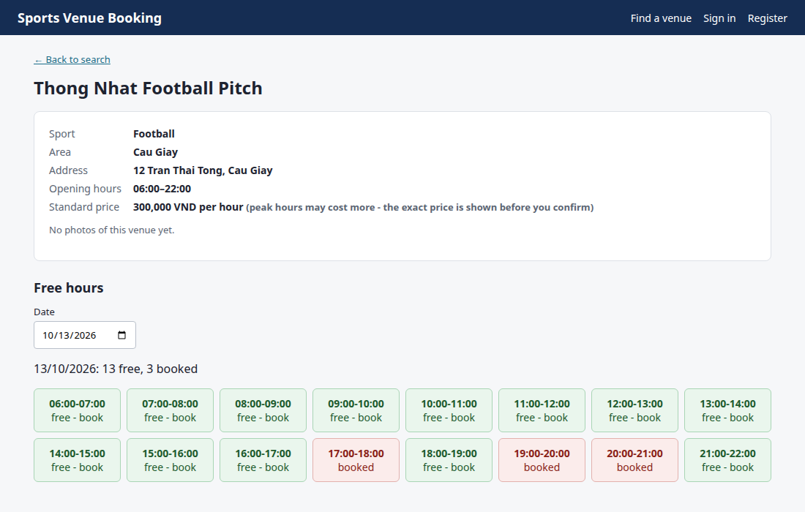 |

The error state also shows the server's own message, for example *"Please choose today or
a later date."* when a date in the past is typed (BR10).

### 2.5 Book - `/booking/{venueId}` (US05)

"The user comes here to choose the time and length of a booking, see the exact price and
confirm it."
Calls: `GET /api/venues/{id}?date=` (the start-time list), `POST /api/bookings` (form).

```
 <- Back to Lan Anh Badminton Court
 Book Lan Anh Badminton Court      45 Duy Tan, Cau Giay - open 06:00-22:00
 +---------------------------------------------------------------------+
 | Date [13/10/2026]  Start time [19:00 v]  Length [2 hours v]  [Show the price] |
 +---------------------------------------------------------------------+
 Price
 Time         Hours   Price/hour   Amount
 19:00-20:00    1      120,000     120,000     <- peak (Tuesday 17:00-20:00)
 20:00-21:00    1       80,000      80,000     <- standard
 Total for 13/10/2026              200,000
 [ Confirm booking ]
 -- or, when every hour of the day is taken --
 +--- This venue is fully booked on 27/10/2026. The nearest date with free hours is 28/10/2026 ---+
```

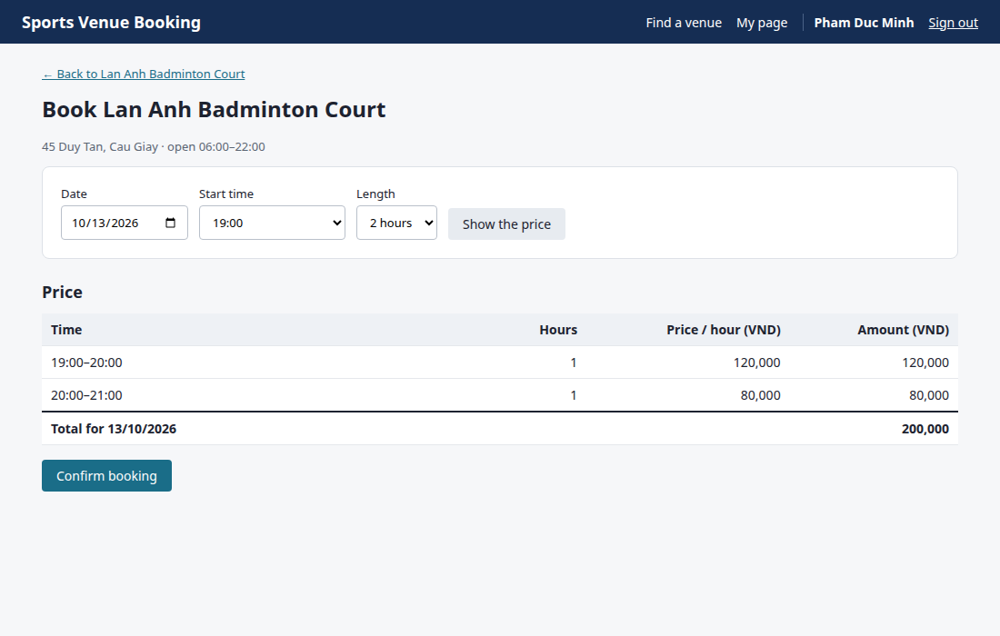
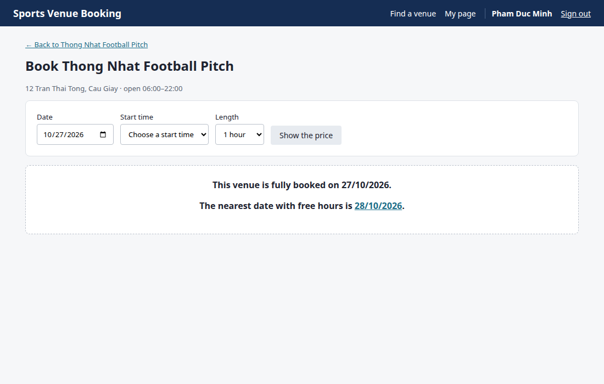

### 2.6 Booking confirmed - `/bookings/{code}` (US05)

"The user comes here to see the booking code and what they will pay."
Calls: none - the page reads the booking it has just written.

```
 [ Booking confirmed. Your booking code is BK-000107. ]
 Booking BK-000107
 Lan Anh Badminton Court - 45 Duy Tan, Cau Giay
 13/10/2026, 19:00-21:00 - status: confirmed
 19:00-20:00  1  120,000  120,000
 20:00-21:00  1   80,000   80,000
 Total                    200,000
 [ My page ]  [ Book another venue ]
```

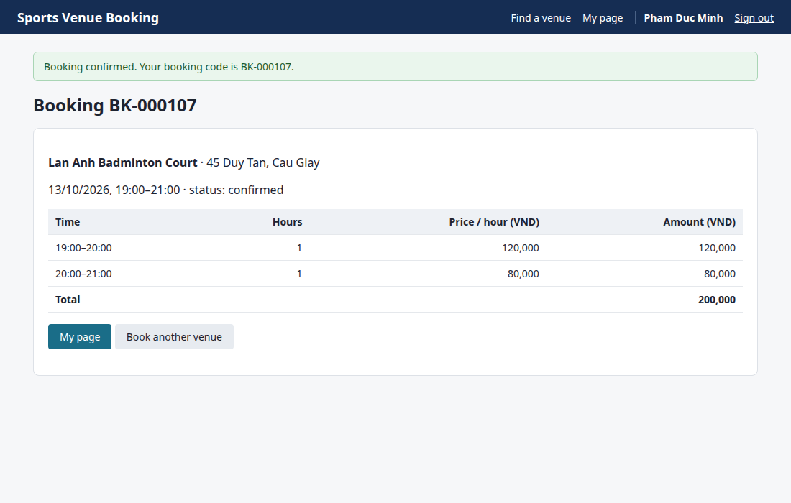

### 2.7 My venues - `/owner/venues` (US06)

"The owner comes here to see every venue they manage and to add a new one."
Calls: `GET /api/owner/venues`.

```
 [ Venue added successfully! ]
 My venues                                        [ Add a venue ]
 Venue (link)              | Sport    | Area     | Address          | Hours       | Price/hour | Photos
 Thong Nhat Football Pitch | Football | Cau Giay | 12 Tran Thai Tong| 06:00-22:00 |    300,000 |      1
 -- or, with no venue yet --
 +-- You have no venues yet. Add your first venue so customers can find and book it. --+
```

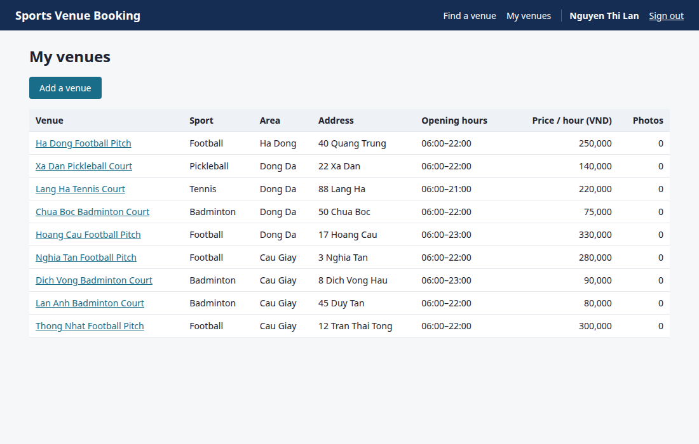

### 2.8 Add a venue - `/owner/venues/new` (US06)

"The owner comes here to put a new venue on the system so customers can find and book it."
Calls: `POST /api/owner/venues` (form, with the photo upload).

```
+------------------------- Add a venue -------------------------+
| [! Please fix the 5 field(s) marked below.                  ] |
| Venue name        [Sa                 ]  3 to 100 characters  |
|                   Venue name must be 3 to 100 characters      |
| Sport             [Choose a sport   v]  <- drop-down only (BR9)|
| Area              [Choose an area   v]  <- 12 Hanoi districts |
| Street address    [12 Tran Thai Tong ]                        |
| Hourly price (VND)[0                 ]                        |
|                   Hourly price must be at least 1,000 VND     |
| Opens at [06:00 v]  Closes at [22:00 v]                       |
| Photo (optional)  [Choose file]  JPG or PNG, at most 5 MB     |
| [ Add venue ]                                                 |
+---------------------------------------------------------------+
```

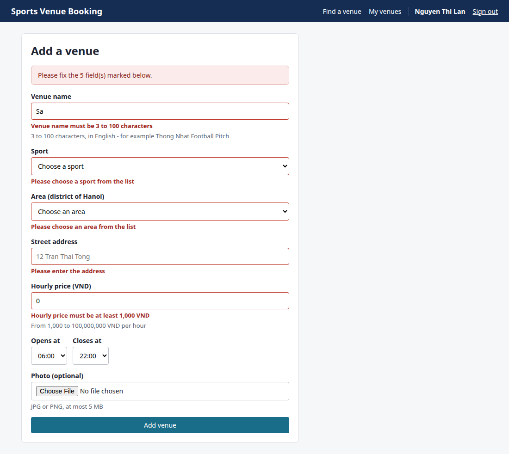

A customer who opens this address directly gets the 403 page instead:

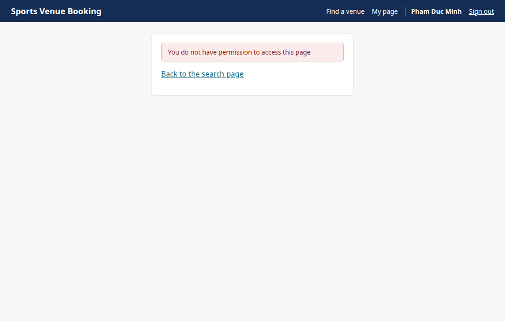

---

## 3. Error messages

Every message below is the exact sentence on screen, taken from the code (`src/auth.py`,
`src/venues.py`, `src/booking.py`, `src/guards.py`). The API code is the one in the
[`design.md`](design.md) section 3 table; the JSON API returns the same sentence as
`{"error": "<message>", "rule": "BR<n>"}`. No screen ever shows a bare code, "Something
went wrong" or a stack trace. Each message says what happened, why, and what to do next -
when the "why" is obvious from the field it sits next to, the message is short.

| API error code | Business rule | The exact message the user sees | Where |
| -------------- | ------------- | ------------------------------- | ----- |
| 409 | BR1 | "This email is already in use" | `/register`, next to Email |
| 400 | BR2 | "Password must be at least 8 characters" | `/register`, next to Password |
| 400 | BR2 | "Password must contain at least one letter and one digit" | `/register` |
| 400 | BR3 | "Phone number must be 10 digits" | `/register`, next to Phone |
| 400 | BR3 | "Phone number must start with 0" | `/register` |
| 410 | BR4 | "This verification link has expired - links last 24 hours. Sign in and press "Send a new link" to get a fresh one." | `/verify` |
| 403 | BR4 | "Please verify your email before booking" | `/booking/{venueId}`, `/dashboard` (with a **Send a new link** button) |
| 401 | BR6 | "Email or password is incorrect" - the same for an unknown email and a wrong password | `/login` |
| 423 | BR5 | "Account temporarily locked. Try again in 15 minutes" | `/login`, from the 5th wrong password in a row |
| 401 | BR8 | "Your session has expired" | `/login`, after 30 minutes without activity |
| 400 | BR9 | "Please choose a sport from the list" / "Please choose an area from the list" | `/search`, `/owner/venues/new` |
| 400 | BR10 | "Please choose today or a later date." | venue page grid (error state), `/booking/{venueId}` |
| 409 | BR11 | "This time slot is no longer available" | `/booking/{venueId}`, when another customer confirmed the same hour first |
| 422 | BR11 | "A booking lasts 1 to 4 hours. Choose a shorter booking." | `/booking/{venueId}` |
| 422 | BR11 | "Lan Anh Badminton Court closes at 22:00, so a booking starting at 21:00 can last at most 1 hour(s)." | `/booking/{venueId}` |
| 422 | BR16 | "Thong Nhat Football Pitch is closed for maintenance at 07:00 on 14/10/2026. Choose another time." | `/booking/{venueId}` |
| 422 | BR13 | "Please enter the venue name" / "Venue name must be 3 to 100 characters" | `/owner/venues/new`, next to Venue name |
| 422 | BR13 | "Hourly price must be at least 1,000 VND" | `/owner/venues/new`, next to Hourly price |
| 403 | BR14 | "You do not have permission to access this page" | a customer opening `/owner/venues/new` |
| 403 | BR14 | "You do not have permission to view this booking" | `/bookings/{code}` of another customer |

Not tied to a business rule, but written the same way: an unknown address gives *"We could
not find that page. Check the address, or start again from the search page."* (404), and a
photo over 5 MB gives *"The photo is larger than 5 MB. Choose a smaller photo and add the
venue again."* (413).

**Rules to break on purpose** (what the instructor can try at the Sprint 3 Review):

| Try this | You see |
| -------- | ------- |
| Book Lan Anh Badminton Court at 21:00 for 3 hours | "... closes at 22:00, so a booking starting at 21:00 can last at most 1 hour(s)." |
| Sign in as `new.customer@example.com` and try to book | "Please verify your email before booking" |
| Register with the email `minh@example.com` | "This email is already in use" |
| As `lan.owner@example.com`, add a venue with the price `0` | "Hourly price must be at least 1,000 VND" |
| Enter a wrong password 5 times for `trang@example.com` | "Account temporarily locked. Try again in 15 minutes" |

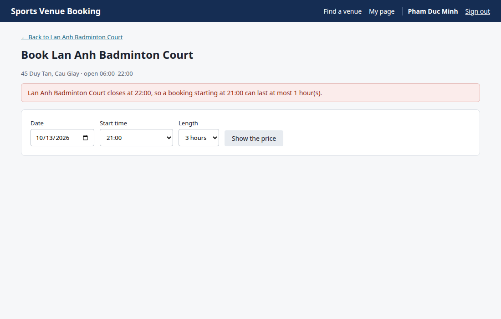
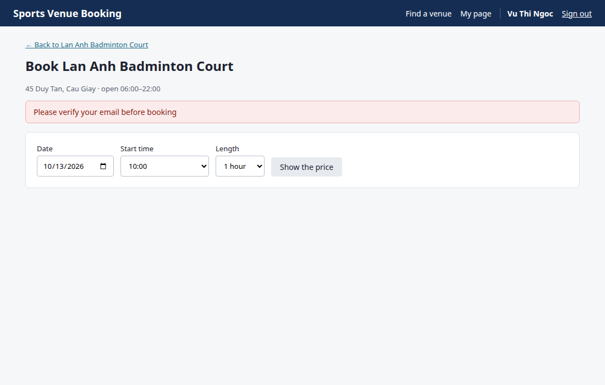

---

## 4. What changed since M2

Drawing the wireframes in section 2 and then building the screens showed four places where
[`design.md`](design.md) did not match what the interface needs. Each change below is
already made in `design.md` in this same pull request, so the two documents agree.

### Change 1 - New table `venue_photo` (data model)

US04 criterion 3 shows a photo gallery on the venue page and US06 criterion 1 lets the
owner upload a photo, but the M2 ERD had **nowhere to store a photo** - `venue` had no
photo column and no table pointed at it. We only noticed when we drew the venue-detail
wireframe (section 2.4) and had to say where the `[photo]` boxes come from.

We added `venue_photo (id, venue_id → venue, file_name UNIQUE, created_at)` rather than a
`photo` column on `venue`, because a venue can have several photos (multiplicity
1 - 0..\*). The file itself is saved in `data/uploads/` under a random name and that folder
is git-ignored, like the database. Updated: `design.md` section 2 (table, relationships and
`images/erd.png`), `src/schema.py`.

### Change 2 - Two new endpoints: `GET /api/owner/venues` and `POST /api/auth/logout` (API)

The My venues wireframe (section 2.7) lists the owner's venues, but M2 had only
`POST /api/owner/venues` to **create** one - no way to **list** them. And every page has a
**Sign out** button in the top bar, but M2 had no endpoint to end a session. Added as rows
15 and 16 of `design.md` section 3, with their error codes (401 when nobody is signed in,
403 when a customer asks for the owner list - BR14).

### Change 3 - Forms post to their page, not to `/api` from JavaScript (architecture)

M2 said each page's data "comes from, or is submitted to, the endpoints". Building the
Create an account screen showed the cost: US01 criterion 3 wants every message next to its
field **and** everything already typed kept in the form. With JavaScript calling
`POST /api/auth/register`, every form would need code to put the values and messages back.
So each form now posts to its own page route (`POST /register`, `POST /booking/{venueId}`,
`POST /owner/venues/new`), which calls **the same service function** as the API endpoint
and re-renders the form with the message. The JSON API stays, unchanged, for the same
rules; only the free-hour grid on `/venues/{id}` calls it from JavaScript, because it is the
one part of a page that reloads without the rest (the four states in section 2.4). This
keeps ADR 1 (server-rendered pages) true. Updated: `design.md` sections 1 and 3.

### Change 4 - The verification email stays a stub and the link is shown on screen (architecture)

M2 planned a real SMTP account "in Sprint 3 through `.env`". The Create an account
wireframe made us follow US01 to its end: after registering, the user must open the link
from the email to be allowed to book (BR4). On the instructor's clean machine there is no
SMTP password - and there must never be a real one in `SETUP.md` - so the story could not
be finished without help. The link is now printed in the terminal **and** shown on the
login page in a blue box (*"No email server is set up on this machine, so here is the link
we just sent: Verify my email"*) while `SHOW_VERIFICATION_LINK=1` in `.env`. The 24-hour
expiry (BR4) still applies to the link. Updated: `design.md` section 1 (Email service row,
`images/architecture.png`), `.env.example`. This is also why US01 is marked
**partly works** in section 1.
